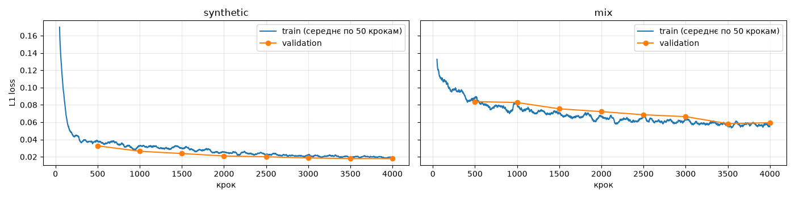
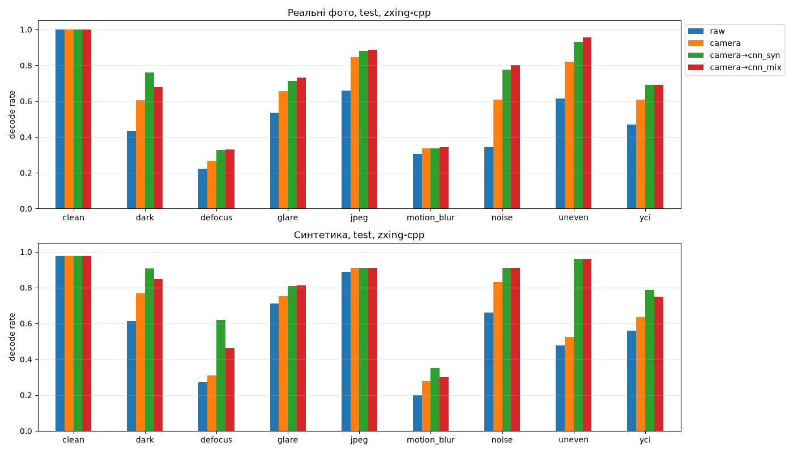
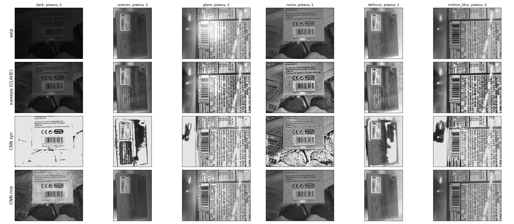
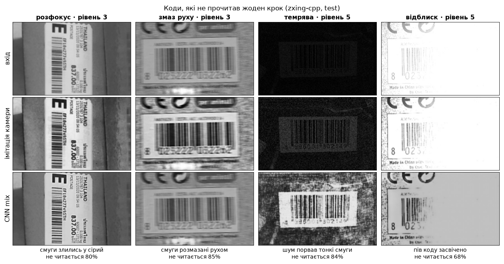

# Robustness in Industrial Computer Vision

Друга спроба для баркодів, які не прочитались (No Read): класична обробка кадру, як у
промислового зчитувача, а потім CNN-реставрація (U-Net) перед декодером.

Презентація: [docs/presentation.pdf](docs/presentation.pdf)

## Проблема

На лінії коробки проїжджають під зчитувачем. Через темряву, нерівне світло, відблиск, шум і
розмиття частина кодів дає **No Read**, і коробка йде в Reject.

Ідея: лінію не зупиняти. Кадр із No Read одразу йде на ПК, який пробує прочитати його ще раз.
При конвеєрі 3 м до точки Reject і швидкості 3 м/с є 1 с, а весь цикл займає ~0.08 с.
Якщо код прочитано, він іде в PLC разом з номером коробки, і коробка їде далі.

## Дані

| Набір | Що на фото | Фото (train / test) | Ліцензія |
|---|---|---|---|
| [Arte-Lab 1D barcode](https://artelab.dista.uninsubria.it/downloads/datasets/barcode/hough_barcode_1d/hough_barcode_1d.html) | товари, EAN-13 | 166 / 81 | CC BY 3.0 |
| [ParcelBar](https://www.kaggle.com/datasets/chommaphatma/inventbar-and-parcelbar-benchmarkbarcodedatasets) | посилки, Code128 | 128 / 55 | CC BY-SA 4.0 |
| [InventBar](https://www.kaggle.com/datasets/chommaphatma/inventbar-and-parcelbar-benchmarkbarcodedatasets) | товари на складі, EAN-13, Code128, Code39 | 291 / 125 | CC BY-SA 4.0 |
| Синтетика (`src/data.py`) | EAN-13, Code128, QR з відомим вмістом | 900 / 90 | власні |

- Правильна відповідь для фото — що прочитав zxing-cpp на оригіналі (для EAN-13/EAN-8 разом з OpenCV).
- Train і test поділені за кодом: жоден товар не потрапляє в обидві частини.
- Пошкодження (7 типів × 5 рівнів сили) накладаються штучно: `dark`, `uneven`, `glare`, `noise`,
  `motion_blur`, `defocus`, `jpeg`.

Автори наборів: Zamberletti, Gallo, Albertini, *Robust Angle Invariant 1D Barcode Detection*,
ACPR 2013; Kamnardsiri, Charoenkwan, Malang, Wudhikarn, *1D Barcode Detection: Novel Benchmark
Datasets and Comprehensive Comparison of Deep Convolutional Neural Network Approaches*,
Sensors 22(22), 8788, 2022.

## Як працює: три спроби до Reject

```
кадр -> декодер                                    1. raw
     -> No Read -> імітація камери -> декодер      2. camera
     -> No Read -> U-Net (CNN)     -> декодер      3. camera→cnn
     -> код у PLC або Reject
```

- **Імітація камери**: легке розмиття, CLAHE (локальне вирівнювання контрасту) і підвищення
  різкості, параметри підібрані на train-фото. Так працюють вбудовані фільтри промислового
  зчитувача: у Cognex DataMan це Equalize (вирівнювання гістограми; CLAHE — його локальна
  версія), Low Pass, Stretch і морфологія
  ([документація Cognex](https://docs.cognex.com/dmst_617/web/EN/DM360_Manual/Content/Topics/DM300_360_470_Manual/ImgFiltering.htm)).
- **Декодери**: у Cognex (1DMax з Hotbars II, 2DMax з PowerGrid) вони закриті, тому тут
  open-source zxing-cpp (усі формати), OpenCV barcode (EAN-13/EAN-8) і WeChat QR.
- **U-Net**: encoder бачить велику картину (темно, відблиск), decoder повертає повний розмір,
  skip connections зберігають тонкі смуги.

## Модель

| Шари | Вихід | Параметри |
|---|---|---|
| Conv-блок → MaxPool2d | 16 × 128×128 | 2 544 |
| Conv-блок → MaxPool2d | 32 × 64×64 | 14 016 |
| Conv-блок → MaxPool2d | 64 × 32×32 | 55 680 |
| Conv-блок → MaxPool2d | 128 × 16×16 | 221 952 |
| **Conv-блок (дно)** | **256 × 8×8** | **886 272** |
| ConvTranspose2d → Conv-блок | 128 × 16×16 | 574 336 |
| ConvTranspose2d → Conv-блок | 64 × 32×32 | 143 808 |
| ConvTranspose2d → Conv-блок | 32 × 64×64 | 36 064 |
| ConvTranspose2d → Conv-блок | 16 × 128×128 | 9 072 |
| Conv2d 1×1 → Sigmoid | 1 × 128×128 | 17 |
| **Разом** | | **1 943 761** |

**Conv-блок** = (Conv2d 3×3 → BatchNorm2d → ReLU) × 2. MaxPool2d зменшує кадр удвічі,
ConvTranspose2d збільшує вдвічі й додає skip connection з енкодера.

**Навчання** на парах: вхід = кадр + штучне пошкодження, ціль = чистий кадр. L1 loss, Adam,
4000 кроків × 32 шматки 128×128, ~12 хв на модель на Mac Mini M4 (MPS). Дві моделі:
**syn** (лише синтетика) і **mix** (синтетика + 585 реальних фото навпіл).



Validation loss не росте, тобто overfitting немає. У mix loss вищий, бо реальні фото як ціль не
ідеально чисті.

## Результати

Тест: 261 реальне фото, яких моделі не бачили (чисті + 7 пошкоджень × рівні 1, 3, 5).

| Метод | zxing-cpp | OpenCV | хибні читання (OpenCV) |
|---|---|---|---|
| raw | 47.0% | 57.0% | 0.5% |
| імітація камери (CLAHE) | 61.0% | 63.7% | 0.7% |
| імітація → CNN syn | 69.0% | 70.9% | 2.1% |
| **імітація → CNN mix** | **69.0%** | 69.7% | **1.3%** |




- Імітація камери дає +14 п.п., CNN додає ще +8 п.п. і повертає 21% кадрів, які не прочитала
  імітація камери.
- Найбільше CNN допомагає з освітленням і шумом: нерівне світло 82→96%, шум 61→80%, відблиск 66→73%.
- syn і mix читають однаково, але mix удвічі рідше дає хибні читання: syn домальовує текстури
  фону. Модель для лінії: mix.

## Чому не 100%



Ці коди не прочитав жоден із трьох кроків. Рівень = сила штучного пошкодження від 1 (слабке)
до 5 (сильне); відсоток — частка таких кадрів у тесті, які не читаються.
Повна таблиця за всіма типами і рівнями: [results/fig_failures.png](results/fig_failures.png).

- **Розмиття — 58% усіх невдач.** Уже з середнього рівня смуги шириною 2–3 пікселі зливаються
  в сірий, і відновлювати нема з чого.
- **Найсильніша темрява й відблиск:** смуги тонуть у чорному або засвічені до білого.
- Помірні пошкодження CNN виправляє: світло, шум і JPEG на рівнях 1–3 не читаються лише в 4% кадрів.

Розмиття може виправити лише обладнання: правильне світло, більше пікселів на смугу, коротка витримка.

**На лінії:** при 10 800 коробках/год і 2% No Read у Reject іде 216 коробок. CNN повертає 21% з
них, тобто лишається ~171 на годину. Справжня промислова камера, ймовірно, сильніша за імітацію,
тож на лінії приріст може бути меншим.

## Висновки

- **+8 п.п. понад імітацію камери:** 47 → 61 → 69%.
- **Суміш даних:** syn і mix читають однаково, але mix удвічі рідше помиляється (1.3% проти 2.1%).
- **Межа методу:** більшість невдач — розмиття, де смуг у кадрі вже немає; тут допоможуть оптика і світло.
- **Доповнення, не заміна:** третя спроба після зчитувача, ~0.08 с при 1 с до Reject.

**Обмеження:** камеру лише імітовано алгоритмами, а справжній зчитувач має сильніший декодер і кілька
кадрів на коробку, тож приріст на лінії може бути меншим. Пошкодження штучні. Правильна відповідь
береться з декодерів на оригіналі, тому в наборі переважають фото, які читаються; у Code39
контрольна сума необов'язкова. Обробка перед CNN (медіанний, білатеральний фільтри, гамма, CLAHE)
приросту не дала.

**Далі:** перевірка на справжньому зчитувачі, фото зі справжнім поганим світлом.

## Структура

```
src/
  data.py          синтетичні коди, пари для навчання, реальні фото
  degradations.py  7 типів пошкоджень × 5 рівнів
  decoders.py      zxing-cpp, OpenCV barcode, WeChat QR -> один формат
  model.py         U-Net і restore() для кадру будь-якого розміру
scripts/
  download_artelab.py   Arte-Lab -> data/raw/artelab/
  download_kaggle.py    ParcelBar, InventBar -> data/raw/parcelbar/, data/raw/inventbar/
notebooks/
  01_train.ipynb        навчання syn і mix -> models/unet_{synthetic,mix}.pt
  02_evaluate.ipynb     raw / імітація камери / CNN на реальних фото і синтетиці
results/                CSV і графіки з 01 і 02
docs/presentation.pdf   презентація
```

Зображення і моделі в git не зберігаються (`data/raw/`, `models/`).

## Як запустити

```bash
source ~/venvs/cv/bin/activate
pip install -r requirements.txt
python scripts/download_artelab.py     # один раз
python scripts/download_kaggle.py      # один раз
jupyter lab notebooks/                 # 01_train -> 02_evaluate
```
