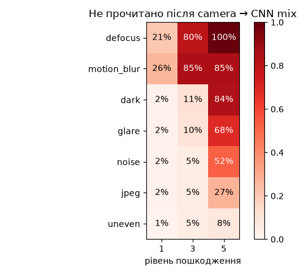

# Robustness in Industrial Computer Vision

CNN-реставрація кадру як друга спроба для баркодів, які не прочитались (No Read) через
погане світло, відблиски, шум і розмиття.

## Задача

На лініях сортування і складах частина баркодів дає **No Read**, і коробка йде в Reject.
Мета: підняти **decode rate** (частку правильно прочитаних кодів), не змінюючи сам декодер,
і перевірити, чи CNN дає більше, ніж класична обробка, яку вже вміє промислова камера.

## Підхід

```
кадр -> декодер                          raw
     -> No Read -> CLAHE -> декодер       camera (імітація фільтрів камери)
     -> No Read -> U-Net -> декодер       camera→cnn
```

- **camera**: легке розмиття, CLAHE (локальне вирівнювання контрасту) і підвищення різкості.
  Параметри підібрані на train-фото.
- **U-Net**: маленький denoising convolutional encoder-decoder (~1.9 млн параметрів)
  зі skip connections, які зберігають тонкі смуги коду.
- **Навчання** на парах (зіпсований, чистий): 7 типів пошкоджень × 5 рівнів (`dark`, `uneven`,
  `glare`, `noise`, `motion_blur`, `defocus`, `jpeg`). Дві моделі: **syn** (лише синтетика)
  і **mix** (синтетика + реальні фото навпіл). ~12 хв на модель на Mac Mini M4 (MPS).
- Декодери: zxing-cpp (усі формати), OpenCV barcode (EAN-13/EAN-8), WeChat QR.

## Структура

```
src/
  data.py          синтетичні коди, пари для навчання, реальні фото і їх розмітка
  degradations.py  7 типів пошкоджень × 5 рівнів
  decoders.py      zxing-cpp, OpenCV barcode, WeChat QR -> один формат
  model.py         U-Net і restore() для кадру будь-якого розміру
scripts/
  download_artelab.py   Arte-Lab -> data/raw/artelab/
  download_kaggle.py    ParcelBar, InventBar -> data/raw/parcelbar/, data/raw/inventbar/
notebooks/
  01_train.ipynb        навчання syn і mix -> models/unet_{synthetic,mix}.pt
  02_evaluate.ipynb     raw / camera / camera→cnn на реальних фото і синтетиці
results/                CSV і графіки з 01 і 02
```

## Дані

| Джерело | Що | Фото (train / test) | Ліцензія |
|---|---|---|---|
| Синтетика (`src/data.py`) | EAN-13, Code128, QR з відомим вмістом | 900 / 90 | власні |
| [Arte-Lab 1D barcode extended](https://artelab.dista.uninsubria.it/downloads/datasets/barcode/hough_barcode_1d/hough_barcode_1d.html) | товари, EAN-13 | 166 / 81 | CC BY 3.0; Zamberletti, Gallo, Albertini, *Robust Angle Invariant 1D Barcode Detection*, ACPR 2013 |
| [ParcelBar](https://www.kaggle.com/datasets/chommaphatma/inventbar-and-parcelbar-benchmarkbarcodedatasets) | посилки, Code128 | 128 / 55 | CC BY-SA 4.0 |
| [InventBar](https://www.kaggle.com/datasets/chommaphatma/inventbar-and-parcelbar-benchmarkbarcodedatasets) | товари на складі, EAN-13, Code128, Code39 | 291 / 125 | CC BY-SA 4.0 |

ParcelBar і InventBar: Kamnardsiri, Charoenkwan, Malang, Wudhikarn, *1D Barcode Detection:
Novel Benchmark Datasets and Comprehensive Comparison of Deep Convolutional Neural Network
Approaches*, Sensors 22(22), 8788, 2022.

Вміст кодів у наборах не вказано: правильна відповідь = те, що zxing-cpp прочитав на оригіналі
(для EAN-13/EAN-8 разом з OpenCV). Train і test поділені за кодом: жоден товар не потрапляє
в обидві частини. Зображення і моделі в git не зберігаються (`data/raw/`, `models/`).

## Як запустити

```bash
source ~/venvs/cv/bin/activate
pip install -r requirements.txt
python scripts/download_artelab.py     # один раз
python scripts/download_kaggle.py      # один раз
jupyter lab notebooks/                 # 01_train -> 02_evaluate
```

## Результати

Тест: 261 реальне фото (чисті + 7 пошкоджень × рівні 1, 3, 5), коди, яких модель не бачила.

| Метод | zxing-cpp | OpenCV | хибні декоди (OpenCV) |
|---|---|---|---|
| raw | 47.0% | 57.0% | 0.5% |
| camera (CLAHE) | 61.0% | 63.7% | 0.7% |
| camera→cnn_syn | 69.0% | 70.9% | 2.1% |
| **camera→cnn_mix** | **69.0%** | 69.7% | **1.3%** |


- Класична обробка дає +14 п.п., CNN додає ще +8 п.п. і повертає 21% кадрів, які не прочитала камера.
- syn і mix читають однаково, але mix удвічі рідше дає хибні декоди: syn домальовує текстури фону.
  Модель для лінії: mix.
- Найбільше CNN допомагає з освітленням і шумом: нерівне світло 82→96%, шум 61→80%.
- CNN запускається лише при No Read камери; весь ланцюжок для такого кадру ~35 мс (Mac Mini M4, MPS).

### Чому не 100%



- 58% усіх невдач дає розмиття (`defocus`, `motion_blur`) з рівня 3: смуги шириною 2–3 пікселі
  зливаються в сірий, інформації для відновлення немає.
- Рівень 5 темряви й відблиску: смуги тонуть у чорному або засвічені до білого.
- На рівнях 1–3 освітлення, шуму і JPEG після CNN не читається лише 4% кадрів.

Такі кадри виправляє обладнання (роздільність, коротка витримка, світло), а не обробка.

## Обмеження

- "camera" лише імітує обробку зчитувача. Справжній зчитувач має сильніший декодер і кілька
  кадрів на коробку, тому приріст на лінії може бути меншим.
- Правильна відповідь береться з декодерів на оригіналі, тому в наборі лишаються переважно
  фото, які читаються; у Code39 контрольна сума необов'язкова, тож мітки трохи менш надійні.
- Пошкодження штучні (накладені на реальні фото).
- Обробка перед CNN (медіанний, білатеральний фільтри, гамма, CLAHE) приросту не дала:
  мережа сама навчилась цієї обробки.
- Нахил і перспективу CNN не виправляє.
